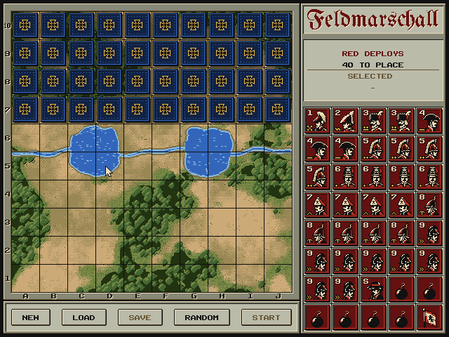

# CX16-FELDMARSCHALL

Feldmarschall is a game of hidden armies for the **Commander X16**, played
by the rules of Stratego: 640x480 and sixteen colours, laid out after the
1990 Accolade Stratego. A terrain map of sand, grass, forest and a
river runs under a thin grid inside a plain stone frame; the panel and
message bar are stone with light grey plates. Beside it, a tray
holds an army of 40 tokens, five across and eight down.

The game is built from **scenes**, one on screen at a time. For now a simple
select screen opens the two that exist; **Escape** returns to it from
anywhere.


### Deploy your army

Blue's army is in place and Red's pieces wait in the tray. Drag them with
the mouse onto Red's home rows:

* Hovering over a piece you can move marks it with gold brackets and names
  it in the info plate.
* Press on a piece to pick it up. It follows the pointer, lifted above the
  board with a shadow, and the brackets show where it will land.
* Release over one of rows 1–4 to put it there. Dropping a piece on another
  red piece swaps them; a piece displaced from the board by one from the
  tray goes back to the tray.
* Deployed pieces can be dragged again to rearrange them, or dropped on the
  tray to return them. Released anywhere else, a piece goes back where it
  came from.
* Once all 40 pieces are placed, the info plate reads **RED IS READY**,
  with the deployment's name if it has one.

The buttons in the message bar (or their keys) work on the whole
deployment:

| Button | Key | |
| --- | --- | --- |
| NEW | N | a blank deployment: every piece back in the tray |
| LOAD | L | choose one of ten built-in deployments or your saved ones |
| SAVE | S | keep the deployment under a name, in one of ten slots |
| RANDOM | R | deploy the whole army at random |
| START | Return | play against the computer with this deployment |

SAVE and START need all 40 pieces on the board. The deployment is kept
when you leave the scene; Escape returns to the menu.

**LOAD** opens a list over Blue's half of the board: ten classic
deployments on the left (Corner Fortress, Centre Keep, Lake Shadow, Scout
Screen, Bomb Wall, False Corner, Left Hook, Right Hook, Turtle and Blitz)
and your saved ones on the right. Pointing at a deployment (or choosing one
with the arrow keys) shows it on your rows at once; click it or press
Return to take it. Escape, or a click outside the list, puts back what you
had.

**SAVE** asks for a name (up to 16 letters, digits, spaces or dashes) and a
slot; it suggests the deployment's own name and slot, or the first free
one. Return or the SAVE button stores it, replacing whatever was in that
slot. Saved deployments live in `DEPLOY.DAT` on the SD card (or in `src/`
in the emulator) and are there the next time you play.




### Play against the computer

Red uses the setup from the deployment, or a random one if it is incomplete;
the computer deploys Blue at random, with its flag on the back row guarded
by bombs.

* Drag one of your pieces to move it. Gold dots mark the empty squares it
  can reach (the two-squares rule may take one away), and the brackets
  appear only over a legal destination.
  Dropping it on an enemy piece attacks.
* In a battle both pieces turn face up: the attacker stands against the
  defender while the message bar names the outcome. Then the loser is
  thrown off the board: a blue piece flies in an arc to its own
  compartment in the tray, a red one drops off the bottom of the screen
  (both, when equal ranks meet). A blue survivor turns face down again:
  as in the board game, you have to remember what you have seen. The
  computer remembers the red pieces it has seen, including a scout that
  gave itself away by moving more than one square.
* Blue thinks for a moment, then its piece slides to its destination.
* The tray shows Blue's army, one compartment per piece: a captured piece
  lands face up in its compartment, so the empty ones are what Blue has
  left.
* Capture the flag, or leave the opponent without a move, to win. Blue's
  army is then revealed; **Return** plays again.


#### Rules

Pieces move one square up, down, left or right, never into a lake. Scouts
move any distance in a straight line and may strike at the end of it (the
modern rule). Bombs and flags never move. In a battle the lower rank number
wins and equal ranks both fall. A miner defuses a bomb, which defeats every
other attacker; the spy defeats the marshal when it attacks, and loses every
other battle. A piece may not move more than five times in a row between
the same two squares, whatever the opponent does (the two-squares rule of
the International Stratego Federation; attacks count too). A piece that has
reached the limit simply shows no dot on the square it would return to.

#### The computer

Blue looks one move ahead and only uses what it may know. The game hands
it a *view* of the board in which every red piece it has not seen is
unknown; it counts how many pieces of each rank Red still hides from the
starting army, the pieces captured and those revealed. An
attack on a hidden piece is weighed over every rank it could be; a piece
that has moved is no bomb or flag. Quiet moves advance, flee squares next
to a known stronger piece, and avoid stepping into danger. A little
randomness keeps games apart.

## Layout

| Element | Pixels | Notes |
| --- | --- | --- |
| Board | (16, 16) – (415, 415) | 10 × 10 squares of 40 px (5 × 5 tiles) |
| Lakes | C5–D6 and G5–H6 | fill their 2 × 2 squares; the river follows the line between rows 5 and 6 |
| Frame | (4, 4) – (427, 427) | stone, 12 px rails; engraved A–J (bottom) and 1–10 (left) |
| Message bar | (4, 428) – (427, 475) | two text lines; the last battle shows both tokens |
| Panel | (428, 4) – (635, 475) | title, info plate and tray, 200 px wide inside |
| Tray | (432, 152) – (631, 471) | 5 × 8 compartments of 40 px |

Red (the player) sets up on rows 1–4 at the bottom and Blue on rows 7–10.
The ranks use the classic European numbering, from **1** Marshal to
**9** Scout, plus **S** Spy, **B** Bomb and **F** Flag. Each army has 40
pieces, one per tray compartment.

* **Title plate**: the masthead *Feldmarschall* in Fraktur, in the deep red
  of the red text and engraved like the frame's lettering, from
  `assets/font/masthead.png`. `assets/scripts/masthead.py` renders it from
  a font file; the build only reads the PNG.
* **Info plate**: whose turn it is (or that Red is deploying), the turn
  number or pieces left to place, and the name of the piece under the
  pointer.
* **Tray**: one compartment per piece of an army, strongest first. While
  deploying it holds Red's pieces still to place; during a game, Blue's
  fallen pieces.
* **Message bar**: instructions, or the last battle with both combatants
  face to face.
* **Plates** float over the board on layer 1 for menus and dialogs.

### Pieces

Every token is a 40 × 40 square: a bevelled rim in army colours and a
30 × 30 portrait. Ranked figures sit right of centre, which leaves the
top-left corner free for the rank. Bombs and flags show no rank and are
centred. Pieces Red hasn't identified show their back, the black cross pattée of the
Iron Cross with a gold rim.

The portraits are heads only, in ink, cream and the army colour, which
gives the faces most of the window. They come from
`assets/pieces/prussian.png`, twelve 30 × 30 portraits in rank order, in
the shared palette. Six pieces wear new headgear over the original
faces and the spy has traded his top hat for a slouch hat; the others,
the bomb and the flag keep their original art:

| Rank | Headgear | Insignia |
| --- | --- | --- |
| 1 Marshal | bicorne worn fore and aft, with a white plume | crossed batons |
| 2 General | bicorne trimmed with white feathers, as Prussian generals wore it | zigzag general's braid |
| 3 Colonel | hussar's fur cap with plume and bag | two pips on twisted braid |
| 4 Major | laced tricorne | twisted braid |
| 5 Captain | crested cavalry helmet | two pips |
| 6 Lieutenant | Black Hussar's mirliton with the death's head | one pip |
| 7 Sergeant | grenadier's mitre cap | chevron |
| 8 Miner | spiked helmet | pick |
| 9 Scout | plain round helmet | double chevron (») |
| S Spy | slouch hat pulled low (*Schlapphut*) | none |

The gold insignia in the bottom-left corner follow the German shoulder
boards: braid for generals and staff officers, pips for company officers,
the pioneers' pick, and a double chevron for the scout, who moves any
distance. They are drawn with an ink
outline over the portrait, like the rank, from `INSIGNIA` in
`assets/scripts/pieces.py`.

The original Napoleonic set is kept in `assets/pieces/napoleonic-sheet.png`;
`PORTRAITS = 'napoleonic'` in `assets/scripts/pieces.py` builds the game
with it. The build then separates the card ground from the black outlines
at full resolution and reduces each card by majority vote to the shared
palette.

## Graphics on VERA

Both layers use 4 bpp 8 × 8 tiles on a 128 × 64 map. A 640 × 480 4 bpp
bitmap would need 150 KB, more than VERA's 128 KB of VRAM.

* **Layer 0** holds the static art: terrain, frame and panel. The procedural
  terrain (`assets/scripts/terrain.py`) has a unique tile at almost every
  position. k-means vector quantisation reduces it to 720 tiles, each a real
  tile taken from the artwork. Layer 0 uses 906 of its 1024 tiles.
* **Layer 1** holds the grid, pieces, move dots and text. Each token carries
  its own square's grid edge and replaces that square's grid tiles, so the
  terrain tiles stay free of lines. Plates and their text (a second copy of
  the font on the plate's light grey) use it too. Layer 1 uses 531 tiles.
* **Blue tokens** reuse the red tiles through palette row 1, which swaps the
  red pair for the blue pair.
* **Text** uses the native 8 × 8 Kakuro font. Glyphs are drawn in ink, and
  palette row *k* replaces ink by colour *k*. No palette row introduces a new
  colour, so the screen shows exactly the 16 base colours.
* **Stone** is palette entry 0. Index 0 is transparent on every layer, and
  VERA shows colour 0 wherever nothing opaque is left. The frame and panel
  can use it on layer 0, though pieces and text can't. The screen margins
  are ink.
* **Sprites**: 0 is the mouse pointer, which the KERNAL mouse driver moves;
  only its image is ours. 1 is the dragged token, 2 the gold brackets and
  3 a second token, for a defender that falls (all 64 × 64). At equal depth a lower sprite number is drawn in front,
  so the pointer stays above the token and the token above the brackets.
  Each of the 13 tokens has a ready-made 64 × 64 sprite image with a
  dithered shadow. Picking up a piece only changes sprite 1's image
  address; the same sprites carry Blue's moves across the board and the
  losers of a battle off it.

| # | Colour | Use | # | Colour | Use |
| -: | --- | --- | -: | --- | --- |
| 0 | `#887` | stone (layer 0) | 8 | `#463` | forest |
| 1 | `#111` | ink, grid, text | 9 | `#231` | deep green |
| 2 | `#EDB` | cream, bevel light | 10 | `#8BD` | shallows |
| 3 | `#CA7` | sand | 11 | `#BBA` | light grey plates, tray |
| 4 | `#985` | khaki | 12 | `#B32` | red army |
| 5 | `#653` | brown, labels | 13 | `#611` | deep red, red text |
| 6 | `#EB4` | gold, selection | 14 | `#36B` | blue army, water |
| 7 | `#784` | olive | 15 | `#124` | deep blue, blue text |

VRAM: layer-0 tiles at `$00000`, layer-0 map at `$08000`, layer-1 map at
`$0C000`, layer-1 tiles at `$10000`, sprite images at `$18000` (tokens),
`$1E800` (brackets) and `$1F000` (pointer), and the palette at `$1FA00`. The game loads each file headerless into VRAM.

## Source code

```
src/
  main.c        the frame loop: reads mouse and keyboard, runs the current scene
  scene.h       scene numbers and the input of the current frame
  core/         the game itself, free of graphics
    pieces      piece types, counts and names
    board       the 10 x 10 board, lakes and home rows
    rules       legal moves and battles
    setup       random setups; the player's deployment, kept between scenes
    presets     ten built-in deployments
    store       the player's named deployments, saved in DEPLOY.DAT
    ai          the computer player, working from one army's view
    random      the game's own random numbers (the same on the X16 and the PC)
  ui/           everything on screen
    video       VERA: layers, text, tokens, sprites, the mouse pointer
    boardview   drawing the board and finding the square under the pointer
    panel       info plate, tray and message bar
    drag        a token lifted on the drag sprite
    dialog      plates floating over the board
    button      raised buttons, made of plate tiles
  native/       the computer player as a PC program (docs/protocol.md)
  bridge/       the computer player alone on the X16, for the parity test
  scenes/       the screens of the game
    menu        the select screen
    deploy      building a setup, with its button bar
    deploy_dialog   the load and save dialogs of the deployment
    play        a game against the computer
```

A scene has an `enter` function, which draws it from scratch, and an
`update` function, which `main()` calls once per frame. `update` returns
the scene to switch to, or `SCENE_STAY`. Before entering a scene, `main()`
clears layer 1 and hides the sprites; layer 0 is shared by all scenes.
Escape returns to the menu, unless a dialog is open.
Game state that outlives a scene (the player's deployment) lives in
`core/`.

## Testing and rating the computer player

The computer player in `src/core` also builds as a PC program,
`build/feldmarschall-engine` (`make native`), which speaks a line-based
protocol on standard input and output (see [docs/protocol.md](docs/protocol.md)).
A referee holds the true position and tells each engine only what its army
may know, so other programs can join in.

* `tools/arena.py` plays matches between any engines. Each pairing plays
  the same two deployments twice with the sides swapped (built-in presets,
  random ones, or a mix), checks every move, and ends a game when a flag
  falls, when the side to move is stuck, or as a draw after 1000 plies.
* `tools/bots.py` provides two baseline opponents, `random` (any legal
  move) and `greedy` (takes what it knows it beats, probes with cheap
  pieces, otherwise advances), written in Python against the protocol.
* `tools/rating.py` turns the results into Elo ratings with a
  Bradley–Terry fit, anchored at the random bot.
* `tools/parity.py` checks that the X16 and the PC choose the same moves:
  it runs `BRIDGE.PRG` (`src/bridge`) in the emulator and the native
  engine side by side on hundreds of positions, with the same random seed.

`make rating` plays 600 games in about half a minute:

| Engine | Elo | 95% | Score |
| --- | ---: | ---: | ---: |
| ai (the game's computer player) | 494 | ±50 | 86% |
| greedy | 286 | ±43 | 54% |
| random | 0 | ±55 | 11% |

Ratings only compare engines within the pool that played; on this scale
a 100-point gap means the stronger engine scores about 64%. The parity
test found a cc65 quirk that made the X16 mis-score attacks on hidden
pieces (cc65 divides a negative `long` by an `unsigned char` as unsigned);
both builds now agree on every tested position, and the X16 needs at most
a tenth of a second per move.

## Building

Requires **cc65**, GNU make 4.3+, and **Python 3** with **Pillow** and **NumPy**.

```sh
make              # build src/FELDMARS.PRG and its graphics
make run          # start it in ../x16-emulator
make dist         # package the runtime files in build/dist/FELDMARSCHALL.ZIP
make test-dist    # boot that package through AUTOBOOT.X16 and check it
make screenshot   # drive it in the AgentBridge emulator, save the screenshots in docs/
make check        # check the built-in deployments and the rules (tests/)
make native       # build the computer player as a PC program (needs gcc)
make rating       # rate it against the baseline bots
make parity       # check that the X16 and the PC choose the same moves
make autoplay     # play 150 turns of random red moves against the computer
```

`tools/autoplay.py` plays the game through the emulator: it reads the board
from memory, drags a random legal red piece each turn, and checks that
every turn changes the board.

`make dist` collects only what the game needs: `FELDMARS.PRG`, a copy named
`AUTOBOOT.X16` that the X16 starts on power-up, the `.BIN` files it loads
(read from the `load_vram` calls in `src/ui/video.c`), a `README.TXT`, the
license and `HASHES.TXT` with SHA-256 sums. Copy the contents of
`build/dist/FELDMARSCHALL` to the root of an SD card to boot straight into the
game. The ZIP has fixed dates, so the same sources give the same archive.

`assets/scripts/build_graphics.py` writes the VRAM resources and `src/gfx.h`.
It also writes previews of layer 0 and the token sheet to `build/preview`.
`assets/scripts/layout.py` holds the screen geometry, which the C code
receives through the generated `gfx.h`.

## Credits

* `assets/font/kakuro-ui.png`: the 8 × 8 font of cx16-kakuro.
* `assets/font/masthead.png`: rendered from
  [UnifrakturMaguntia](https://github.com/google/fonts/tree/main/ofl/unifrakturmaguntia)
  (SIL Open Font License).
* Terrain and panel design inspired by Stratego (Accolade, 1990).

## License

GPL-3.0-or-later; see [LICENSE](LICENSE).
