# CX16-FELDMARSCHALL

[](https://github.com/ifilot/cx16-feldmarschall/actions/workflows/build.yml)
[](https://ifilot.github.io/cx16-feldmarschall/)
[](https://www.gnu.org/licenses/gpl-3.0)

**[Play it in your browser](https://ifilot.github.io/cx16-feldmarschall/)**, or
download `FELDMARSCHALL.ZIP` from the
[releases](https://github.com/ifilot/cx16-feldmarschall/releases).

Feldmarschall is a game of hidden armies for the **Commander X16**, played
by the rules of Stratego: 640x480 with 16-color tiles and selectable field
and army palettes, laid out after the
1990 Accolade Stratego. A terrain map of sand, grass, forest and a
river runs under a thin grid inside a plain stone frame; the panel and
message bar are stone with light grey plates. Beside it, a tray
holds an army of 40 tokens, five across and eight down.

The game opens with a sixteen-color Prussian marshal portrait in a beveled
gold frame on black, with the version and compilation date below.
Press **Enter** to continue to the menu.

Mouse, keyboard and SNES-compatible gamepads can be used together. Menus
follow pointer movement or a fresh click; a stationary mouse no longer
overrides keyboard selection. When events arrive in the same frame, the
keyboard takes precedence. Keyboard shortcuts remain available, with hints
kept off the game screen except the title prompt.

A connected controller on ports 1–4 uses **D-pad** to move the shared pointer,
**A** to click (hold while moving to drag), **B** or **Select** to go back,
and **Start** to confirm. **X** gives fine positioning and **Y** faster travel.
Releasing the pad leaves the pointer in place; moving the mouse takes over
from there. `make run` enables emulator controller port 1 with `-joy1`; add
`-joy2` through `-joy4` for other ports. Controller support uses the KERNAL
`joystick_get` and `mouse_set_position` APIs (ROM R47+).

The supplied Feldmarschall soundtrack plays through VERA PSG: a title theme,
deployment music, four battle tracks that rotate on new games, and one-shot
victory/defeat cues. Draws use the supplied neutral battle-tie effect. Pieces,
battles, bombs, defusing, menus, deployment and saving have matching effects.
In the in-game **Menu** (Escape), select **Music On/Off** and **Sound Effects On/Off**
to mute or re-enable each independently for the current session. Missing audio files leave gameplay
usable without sound.

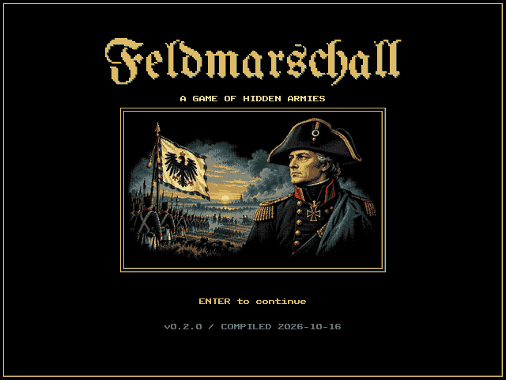

The main menu offers **Setups**, **Skirmish**,
**Load game**, **Options**, **About**, and **Demo**. Playing begins with
game settings, followed by army preparation: arrange or load your army,
then choose **Start**.

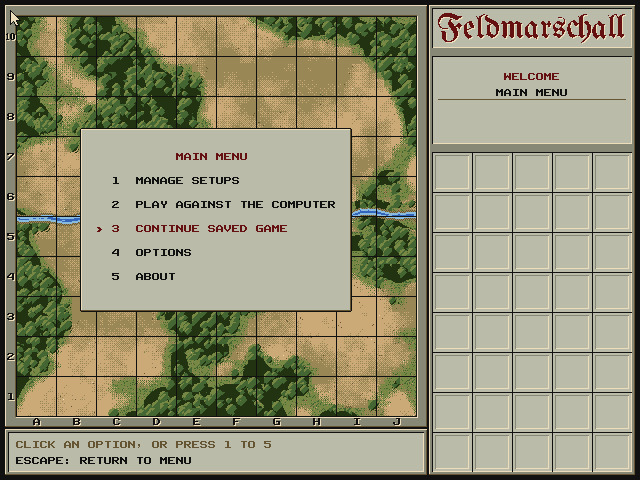

Choose **5 ABOUT** for the program name, author, GitHub repository, version,
and compilation date. The version (currently **v0.2.0**) is set in
`tools/build_info.py`; the date is generated at build time. Enter, Escape,
or Back returns to the menu.

Choose **3 LOAD GAME** to pick up the game saved from the game
menu (see below). Without a saved game the info plate says so.

Choose **4 OPTIONS** to select independent field styles, army colors and
rank numbers in the right-hand tray area. Click a profile to preview it on the board, or
use **Tab** to switch groups and **Up/Down** or the number keys to select.
**Enter**, **Escape**, or **Back** returns to the menu and saves the choices
in `COLORS.DAT`. **Summer Campaign** and **Muted Campaign** retain the original
terrain with its classic and charcoal/brass palettes. **Ivory Paper** offers
a plain board surface; **Polished Tiles** adds raised ceramic squares with
bright glazed edges, shaded bevels, and grout channels. Both use hatched blocked areas
at the same game coordinates. Army colors are
**Classic Red/Blue**, **Teal/Copper**, **Forest/Ivory**, **Amber/Violet**,
**Mint/Rose**, and **Cyan/Orange**. The last three draw inspiration from
syntax-highlighting colors. All pieces use
the original square frames and portraits.

**Rank numbers** chooses how the tokens, the info plate and the rescue keys
number the ranks: **Classic** counts down from **1** Marshal to **9** Scout
with **S** for the Spy; **Modern** counts up from **1** Spy and **2** Scout
to **10** Marshal. Bombs and flags carry no number in either.

Field selections affect only the board surface and its grid. The frame,
coordinates, sidebar, tray, dialogs, and controls keep the classic UI style.

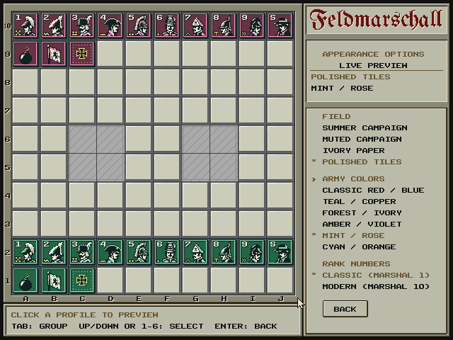

### Setups and deploy your army

**Setups** lets you create, load, and save army arrangements. Its
**Back** button returns to the menu. **Skirmish** opens the
same editor as a pre-game deployment screen, with **Start** in place of Back.
The opponent's hidden army appears only in pre-game deployment.

Your pieces wait in the tray. Drag them onto your four home rows:

* Hovering over a piece you can move marks it with gold brackets and names
  it in the info plate.
* Press on a piece to pick it up. It follows the pointer, lifted above the
  board with a shadow, and the brackets show where it will land.
* Release over one of rows 1–4 to put it there. Dropping a piece on another
  red piece swaps them; a piece displaced from the board by one from the
  tray goes back to the tray.
* Deployed pieces can be dragged again to rearrange them, or dropped on the
  tray to return them. Released anywhere else, a piece goes back where it
  came from.
* Once all 40 pieces are placed, the info plate reads **SETUP COMPLETE** in
  setup management, or **READY TO PLAY** before a match, with the setup's
  name if it has one.

The buttons in the message bar (or their keys) work on the whole
deployment:

| Button | Key | |
| --- | --- | --- |
| NEW | N | a blank deployment: every piece back in the tray |
| LOAD | L | choose one of ten built-in deployments or your saved ones |
| SAVE | S | keep the deployment under a name, in one of ten slots |
| RANDOM | R | deploy the whole army at random |
| BACK | Return | return to the menu from Setups |
| START | Return | begin the match from pre-game deployment |

SAVE and START need all 40 pieces on the board; BACK also works with an
unfinished setup. The arrangement is kept when you leave, so a setup built
in Setups is available when you choose Skirmish. Escape returns to the menu.

**LOAD** opens a list over Blue's half of the board: ten classic
deployments on the left (Corner Fortress, Centre Keep, Lake Shadow, Scout
Screen, Bomb Wall, False Corner, Left Hook, Right Hook, Turtle and Blitz)
and your saved ones on the right. Pointing at a deployment (or choosing one
with the arrow keys) shows it on your rows at once; click it or press
Return to take it. Escape, or a click outside the list, puts back what you
had.

**SAVE** asks for a name (up to 16 letters, digits, spaces or dashes) and a
slot; it suggests the deployment's own name and slot, or the first free
one. Return or the SAVE button stores it, replacing whatever was in that
slot. Saved deployments live in `DEPLOY.DAT` on the SD card (or in `src/`
in the emulator) and are there the next time you play.

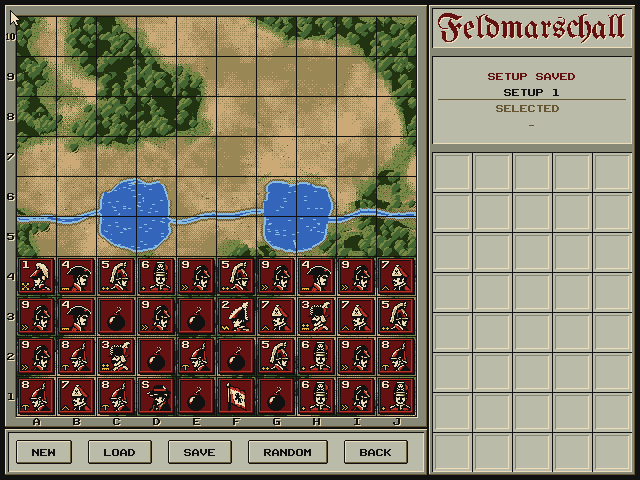

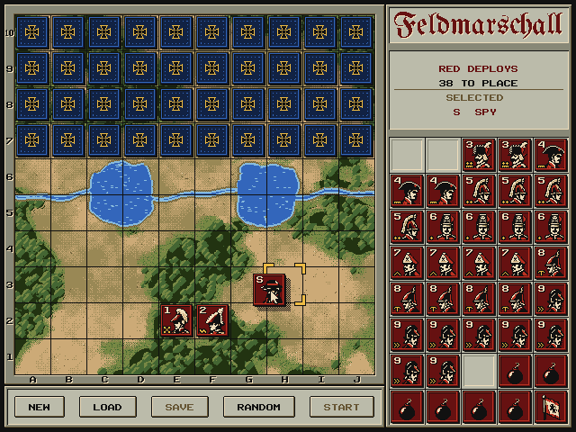

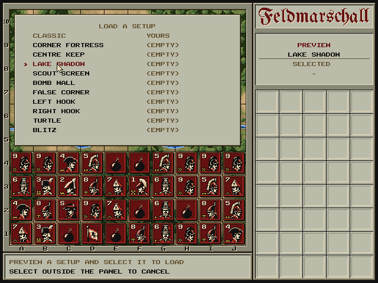

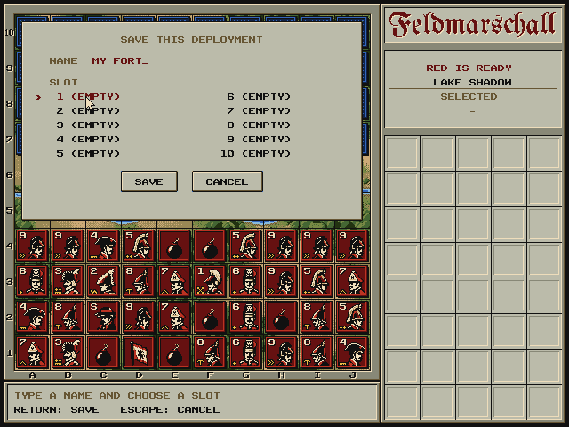

### Skirmish

Choose Skirmish to open a floating menu over the battlefield for the optional Masters
rules before every match. The **Marshal’s Orders** artwork pairs a Fraktur **New game** masthead
with Prussian officer portraits and a command-table battle plan.
Select a rule to read its explanation beside the list.
All six options start disabled; choices are remembered for the current session.
Click a rule or press **1–6** to toggle it; **Up/Down** and **Space** also work.
**Classic Rules** (or **C**) disables every variant. **Continue** or **Return**
opens army preparation; **Back** or **Escape** returns to the menu.

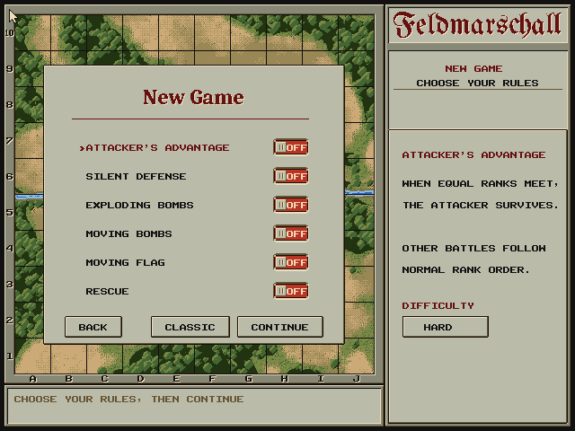

Then review or edit your army. You can load a
saved or built-in setup, place the pieces yourself, or choose Random. Start
is enabled once all 40 pieces are placed, and the match uses that exact
arrangement. The computer deploys its army at random, with its flag on the
back row guarded by bombs.

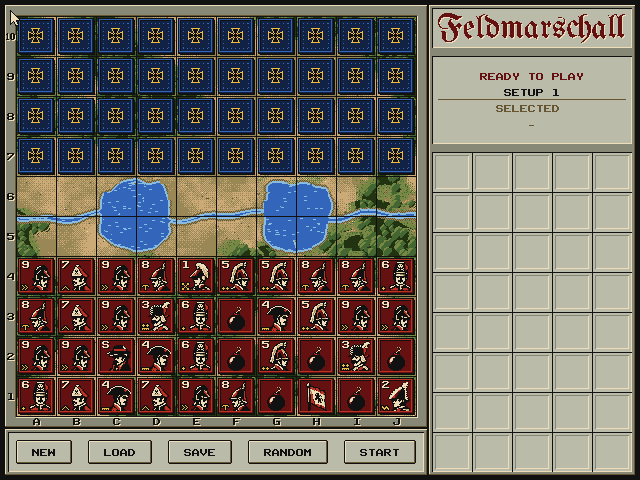

* Drag one of your pieces to move it. Gold dots mark the empty squares it
  can reach (the two-squares rule may take one away), and the brackets
  appear only over a legal destination.
  Dropping it on an enemy piece attacks.
* In a battle both pieces turn face up: the attacker stands against the
  defender while the message bar names the outcome. Then the loser is
  thrown off the board: a blue piece flies in an arc to its own
  compartment in the tray, a red one drops off the bottom of the screen
  (both, when equal ranks meet). A blue survivor turns face down again:
  as in the board game, you have to remember what you have seen. The
  computer remembers the red pieces it has seen, including a scout that
  gave itself away by moving more than one square.
* Blue thinks for a moment, then its piece slides to its destination.
* The tray shows Blue's army, one compartment per piece: a captured piece
  lands face up in its compartment, so the empty ones are what Blue has
  left.
* Capture the flag, or leave the opponent without a move, to win. If a
  battle leaves neither army able to move, the game is a draw. Blue's army
  is then revealed. A black result screen shows a framed 320 × 192
  illustration in sixteen colors, the outcome, turn and reason:
  **New game** opens game settings, **View the board** restores the
  revealed armies (Space or a click brings the result back), and
  **Main menu** (or Escape).
  Up/Down selects an option and Return confirms it; the choices also accept
  numbers and mouse clicks. Each outcome loads independently into layer 0,
  and leaving the result restores the selected field and army palettes.
* **Menu** opens the game menu over the board and pauses the game; Escape
  or the gamepad's B does the same. **Resume**, **Save game**, which writes
  the game to `GAME.DAT` and keeps the menu open, **Quit to menu**, and
  **Music on/off**, and **Sound effects on/off**. Pressed
  during the computer's move or a battle, the menu opens as soon as that
  move is over, so a saved game never holds half a move. A saved game
  keeps the board, both armies' casualties, the variants in play and the
  turn; **3 Load game** in the main menu resumes it.

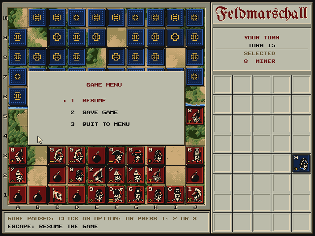

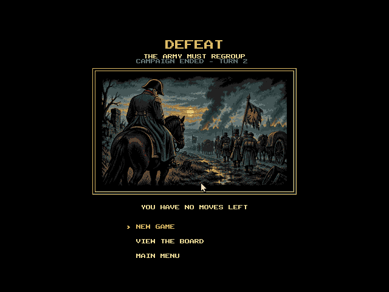

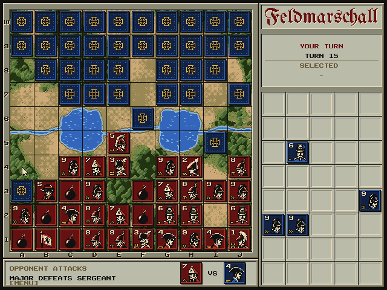

#### Rules

Pieces move one square up, down, left or right, never into a lake. Scouts
move any distance in a straight line and may strike at the end of it (the
modern rule). Bombs and flags never move. In a battle the higher rank wins
(the lower number in the classic numbering) and equal ranks both fall. A miner defuses a bomb, which defeats every
other attacker; the spy defeats the marshal when it attacks, and loses every
other battle. A piece may not move more than five times in a row between
the same two squares, whatever the opponent does (the two-squares rule of
the International Stratego Federation; attacks count too). A piece that has
reached the limit simply shows no dot on the square it would return to.

The Game Settings screen offers these variants from the
[Stratego Masters rulebook](https://www.playmonster.com/wp-content/uploads/2018/06/StrategoMasters_Rules.pdf):

| Option | Effect |
| --- | --- |
| Attacker's Advantage | The attacker survives a battle between equal ranks. |
| Silent Defense | The defender's rank stays secret unless a Scout attacks. Previously disclosed ranks remain known. Hidden enemy casualties use blank tokens and sequential tray slots. |
| Exploding Bombs | A non-Miner and the Bomb both fall; a Miner still survives. |
| Moving Bombs | Bombs can move one square but cannot attack. Enables Exploding Bombs; disabling explosions also disables moving bombs. |
| Moving Flag | The Flag can move one square but cannot attack. Reaching the enemy back row also wins. |
| Rescue | An eligible piece reaching the enemy back row can restore one captured piece to an empty home square. Two rescues per army, once per rescuing piece; Scouts cannot rescue and Bombs cannot be restored. |

During a player rescue, the tray temporarily shows your eligible casualties.
Click a casualty (or press its rank: **1–9** / **S**, or **0–9** with
modern numbers, 0 for the Marshal), then an empty square in your
first four rows. **Return** or **Escape** skips the optional rescue.
The computer chooses its own reinforcement and return square. A rescued
piece retains disclosure only if its captured rank was known.

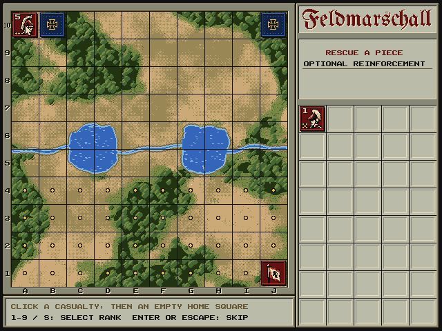

### Demo

Choose **Demo** from the main menu to watch two computer armies battle.
Both deploy at random and use the current game rules. Both armies are face up
for spectators; each AI still sees only enemy ranks revealed in battle and
keeps its own move history. Moves, battles and rescues run automatically.

**Menu** (or Escape / gamepad B) pauses between moves. You can resume, toggle music and effects independently,
or quit. Saving is disabled in demo mode, so it cannot overwrite a saved
player game. **New game**
on a demo's result screen starts another computer battle. Watching a demo
preserves your prepared army and saved deployment slots.

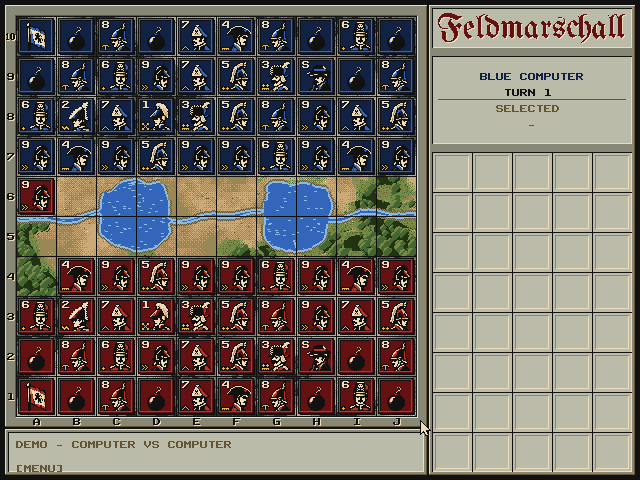

#### The computer

The computer evaluates legal moves using only its army's view. Undisclosed
enemy ranks are replaced with unknowns; Silent Defense also withholds hidden
casualty ranks. Attacks on unknowns use remaining-rank counts and movement
evidence, excluding stationary Bombs and Flags after a piece has moved.

Each piece selects a reachable enemy objective and keeps a small preference
for continuing that plan. Breadth-first routes guide it around lakes and
occupied squares. Tactical evaluation checks the resulting occupancy for
adjacent enemies and long scout rays, prioritizes immediate victory and
confirmed threats to its own flag, and preserves specialist value while the
opposing threat remains. Small random adjustments vary similar choices.
Normal uses this evaluator. Easy skips route planning and varies choices
more; Hard checks the best material reply to six shortlisted moves, weighting
possible concealed combat outcomes. Every level receives the same information.
Choose difficulty by clicking its button in New Game, or with the left/right
arrow keys. Difficulty is retained in saved games; older saves use Normal. See
[the AI comparison](docs/ai-comparison.md) for measured results and limits.

## Layout

| Element | Pixels | Notes |
| --- | --- | --- |
| Board | (16, 16) – (415, 415) | 10 × 10 squares of 40 px (5 × 5 tiles) |
| Lakes | C5–D6 and G5–H6 | fill their 2 × 2 squares; the river follows the line between rows 5 and 6 |
| Frame | (4, 4) – (427, 427) | stone, 12 px rails; engraved A–J (bottom) and 1–10 (left) |
| Message bar | (4, 428) – (427, 475) | two text lines; the last battle shows both tokens |
| Panel | (428, 4) – (635, 475) | title, info plate and tray, 200 px wide inside |
| Tray | (432, 152) – (631, 471) | 5 × 8 compartments of 40 px |

Red (the player) sets up on rows 1–4 at the bottom and Blue on rows 7–10.
The ranks use the classic European numbering, from **1** Marshal to
**9** Scout, plus **S** Spy, **B** Bomb and **F** Flag, unless Options
selects the modern one (1 Spy to 10 Marshal). Each army has 40
pieces, one per tray compartment.

* **Title plate**: the masthead *Feldmarschall* in Fraktur, in the deep red
  of the red text and engraved like the frame's lettering, from
  `assets/font/masthead.png`. `assets/scripts/masthead.py` renders it from
  a font file; the build only reads the PNG.
* **Info plate**: whose turn it is (or that Red is deploying), the turn
  number or pieces left to place, and the name of the piece under the
  pointer.
* **Tray**: one compartment per piece of an army, strongest first. While
  deploying it holds Red's pieces still to place; during a game, Blue's
  fallen pieces.
* **Message bar**: instructions, or the last battle with both combatants
  face to face.
* **Plates** float over the board on layer 1 for menus and dialogs.

### Pieces

Every token is a 40 × 40 square: a bevelled rim in army colours and a
30 × 30 portrait. Ranked figures sit right of centre, which leaves the
top-left corner free for the rank. Bombs and flags show no rank and are
centred. The build draws every token twice: `L1TILES.BIN` and
`SPRITES.BIN` carry the classic numbers, `RANKTIL.BIN` and `RANKSPR.BIN`
the modern ones, which the game loads over them when that numbering is
selected. The Marshal's modern **10** squeezes a narrow one beside the
zero to stay clear of the portrait. Pieces Red hasn't identified show their back, the black cross pattée of the
Iron Cross with a gold rim.

The portraits are heads only, in ink, cream and the army colour, which
gives the faces most of the window. They come from
`assets/pieces/prussian.png`, twelve 30 × 30 portraits in rank order, in
the shared palette. Six pieces wear new headgear over the original
faces and the spy has traded his top hat for a slouch hat; the others,
the bomb and the flag keep their original art:

| Rank | Headgear | Insignia |
| --- | --- | --- |
| 1 Marshal | bicorne worn fore and aft, with a white plume | crossed batons |
| 2 General | bicorne trimmed with white feathers, as Prussian generals wore it | zigzag general's braid |
| 3 Colonel | hussar's fur cap with plume and bag | two pips on twisted braid |
| 4 Major | laced tricorne | twisted braid |
| 5 Captain | crested cavalry helmet | two pips |
| 6 Lieutenant | Black Hussar's mirliton with the death's head | one pip |
| 7 Sergeant | grenadier's mitre cap | chevron |
| 8 Miner | spiked helmet | pick |
| 9 Scout | plain round helmet | double chevron (») |
| S Spy | slouch hat pulled low (*Schlapphut*) | none |

The gold insignia in the bottom-left corner follow the German shoulder
boards: braid for generals and staff officers, pips for company officers,
the pioneers' pick, and a double chevron for the scout, who moves any
distance. They are drawn with an ink
outline over the portrait, like the rank, from `INSIGNIA` in
`assets/scripts/pieces.py`.

The original Napoleonic set is kept in `assets/pieces/napoleonic-sheet.png`;
`PORTRAITS = 'napoleonic'` in `assets/scripts/pieces.py` builds the game
with it. The build then separates the card ground from the black outlines
at full resolution and reduces each card by majority vote to the shared
palette.

## Graphics on VERA

Both layers use 4 bpp 8 × 8 tiles on a 128 × 64 map. A 640 × 480 4 bpp
bitmap would need 150 KB, more than VERA's 128 KB of VRAM.

* **Layer 0** holds the static art: terrain, frame and panel. The procedural
  terrain (`assets/scripts/terrain.py`) has a unique tile at almost every
  position. k-means vector quantisation reduces it to 720 tiles, each a real
  tile taken from the artwork. Layer 0 uses 906 of its 1024 tiles.
* **Layer 1** holds the grid, pieces, move dots and text. Each token carries
  its own square's grid edge and replaces that square's grid tiles, so the
  terrain tiles stay free of lines. Plates and their text (a second copy of
  the font on the plate's light grey) use it too. The battle panel uses
  separate tokens without grid edges. Layer 1 uses 1,015 tiles, including
  both token sets, button states, and serif headings. Main Menu, New Game, and the in-game pause menu
  use serif headings with a single red underline and left-aligned buttons with a
  red selection text and a brief recessed press animation. New Game
  keeps the chosen battlefield and palettes visible behind its floating
  rule labels and red/off or green/on toggle switches. Knob position and
  ON/OFF labels also show the state. Descriptions appear in the right-hand panel.

* **Palettes**: row 0 holds the fixed classic UI colors; row 6 holds the
  selected board colors. Layer-0 board tiles and layer-1 grid tiles select
  row 6, while the surrounding frame and panels select row 0.
  Rows 1 and 2 hold the two
  armies; both reuse the same token tiles, with row 2 replacing the uniform
  pair at indices 12 and 13 by the second army's colors. Dragged and animated
  tokens use the same army palette offsets as their board tiles.
* **Text** uses the native 8 × 8 Kakuro font. Glyphs are drawn in ink, and
  palette rows 3–5 replace ink by the field's secondary text color and the
  two army text colors. Their plate backgrounds retain the classic UI colors.
  Independent field and army choices can show more than sixteen distinct
  colors across the screen. Field artwork loads into the same layer-0 VRAM
  space when the style changes. Profile definitions live in
  `assets/scripts/color_profiles.py` and are compiled into the game.
* **Stone** is palette entry 0. Index 0 is transparent on every layer, and
  VERA shows colour 0 wherever nothing opaque is left. The frame and panel
  can use it on layer 0, though pieces and text can't. The screen margins
  are ink.
* **Sprites**: 0 is the mouse pointer, which the KERNAL mouse driver moves;
  only its image is ours. 1 is the dragged token, 2 the gold brackets and
  3 a second token, for a defender that falls (all 64 × 64). At equal depth a lower sprite number is drawn in front,
  so the pointer stays above the token and the token above the brackets.
  Each of the 13 tokens has a ready-made 64 × 64 sprite image with a
  dithered shadow. Picking up a piece only changes sprite 1's image
  address; the same sprites carry Blue's moves across the board and the
  losers of a battle off it.

The original profile uses the following base colors:

| # | Colour | Use | # | Colour | Use |
| -: | --- | --- | -: | --- | --- |
| 0 | `#887` | stone (layer 0) | 8 | `#463` | forest |
| 1 | `#111` | ink, grid, text | 9 | `#231` | deep green |
| 2 | `#EDB` | cream, bevel light | 10 | `#8BD` | shallows |
| 3 | `#CA7` | sand | 11 | `#BBA` | light grey plates, tray |
| 4 | `#985` | khaki | 12 | `#B32` | red army |
| 5 | `#653` | brown, labels | 13 | `#611` | deep red, red text |
| 6 | `#EB4` | gold, selection | 14 | `#36B` | blue army, water |
| 7 | `#784` | olive | 15 | `#124` | deep blue, blue text |

VRAM: layer-0 tiles at `$00000`, layer-0 map at `$08000`, layer-1 map at
`$0C000`, layer-1 tiles at `$10000`, sprite images at `$18000` (tokens),
`$1E800` (brackets) and `$1F000` (pointer), and the palette at `$1FA00`. The game loads each file headerless into VRAM.

## Source code

```
src/
  main.c        the frame loop: reads mouse and keyboard, runs the current scene
  scene.h       scene numbers and the input of the current frame
  core/         the game itself, free of graphics
    pieces      piece types, counts and names
    board       the 10 x 10 board, lakes and home rows
    rules       legal moves and battles
    setup       random setups; the player's deployment, kept between scenes
    presets     ten built-in deployments
    store       the player's named deployments (DEPLOY.DAT) and the saved game (GAME.DAT)
    ai          the computer player, working from one army's view
    random      the game's own random numbers (the same on the X16 and the PC)
  ui/           everything on screen
    video       VERA: layers, text, tokens, sprites, the mouse pointer
    sound       banked ZSMKit music and effects, scene changes and mute
    boardview   drawing the board and finding the square under the pointer
    panel       info plate, tray and message bar
    drag        a token lifted on the drag sprite
    dialog      plates floating over the board
    button      raised buttons, made of plate tiles
  native/       the computer player as a PC program (docs/protocol.md)
  bridge/       the computer player alone on the X16, for the parity test
  scenes/       the screens of the game
    menu        the select screen
    deploy      building a setup, with its button bar
    deploy_dialog   the load and save dialogs of the deployment
    play        a game against the computer
```

A scene has an `enter` function, which draws it from scratch, and an
`update` function, which `main()` calls once per frame. `update` returns
the scene to switch to, or `SCENE_STAY`. Before entering a scene, `main()`
clears layer 1 and hides the sprites; layer 0 is shared by all scenes.
Escape returns to the menu, unless a dialog is open; in a game it opens
the game menu.
Game state that outlives a scene (the player's deployment) lives in
`core/`.

### Developer scenarios

Type **DEV** at the main menu to swap its entries for test scenarios
(`src/scenes/dev.c`); type it again, or press Escape, to get the menu back.
Each scenario puts a game straight into a situation worth testing, with
everything else already captured:

| # | Scenario | What happens |
| -: | --- | --- |
| 1 | Lose: last piece taken | Blue moves first; its Marshal takes your last movable piece, a Sergeant, and you have no moves left |
| 2 | Win: last enemy taken | your Marshal takes Blue's last movable piece |
| 3 | Draw: no one can move | the last movers, two Sergeants, fall together |
| 4 | Win: capture the flag | your Captain stands next to Blue's flag |
| 5 | Lose: flag captured | Blue moves first and takes your flag, which it has seen |
| 6 | Rescue a piece | the Rescue variant, with your Major one step from Blue's back row |

A scenario is a few bytes: the variants, who moves first, and the pieces as
(square, cell) pairs; `play_position()` counts the missing pieces as fallen.
`make test-endings` plays them all through the emulator and checks the
illustrated results, exact artwork and board/palette restoration. The game stays on the scenario list until you leave it.

### Memory

The program, its data and its variables share the X16's 38 KB of main RAM
with cc65's C stack. Since every function keeps its locals static
(`#pragma static-locals`), the stack needs only a few dozen bytes: 36 at
most in a long game, measured by filling it with a marker byte in the
emulator. `src/Makefile` therefore reserves 1 KB for it instead of cc65's
default 2 KB; `src/FELDMARS.map` shows how much room is left below it.

## Testing and rating the computer player

The computer player in `src/core` also builds as a PC program,
`build/feldmarschall-engine` (`make native`), which speaks a line-based
protocol on standard input and output (see [docs/protocol.md](docs/protocol.md)).
A referee holds the true position and tells each engine only what its army
may know, so other programs can join in.

* `tools/arena.py` plays matches between any engines. Each pairing plays
  the same two deployments twice with the sides swapped (built-in presets,
  random ones, or a mix), checks every move, and ends a game when a flag
  falls, when the side to move is stuck, or as a draw after 1000 plies.
* `tools/bots.py` provides two baseline opponents, `random` (any legal
  move) and `greedy` (takes what it knows it beats, probes with cheap
  pieces, otherwise advances), written in Python against the protocol.
* `tools/rating.py` turns the results into Elo ratings with a
  Bradley–Terry fit, anchored at the random bot.
* `tools/parity.py` checks that the X16 and the PC choose the same moves:
  it runs `BRIDGE.PRG` (`src/bridge`) in the emulator and the native
  engine side by side on hundreds of positions, with the same random seed.

The pre-upgrade v0.2.0 AI had these historical results over 600 games
against the baseline bots (these are not human Elo ratings):

| Engine | Elo | 95% | Score |
| --- | ---: | ---: | ---: |
| ai (the game's computer player) | 494 | ±50 | 86% |
| greedy | 286 | ±43 | 54% |
| random | 0 | ±55 | 11% |

Ratings only compare engines within the pool that played; on this scale
a 100-point gap means the stronger engine scores about 64%. The parity
test found a cc65 quirk that made the X16 mis-score attacks on hidden
pieces (cc65 divides a negative `long` by an `unsigned char` as unsigned);
both builds now agree on every tested position. The upgraded AI matched on
500 fresh positions per difficulty. The maximum measured times were 14 frames
(0.23 seconds) for Easy, 24 (0.40) for Normal and 45 (0.75) for Hard. Normal's
optimizations preserved 17,417 decisions across 30 complete games against the
previous planned evaluator, whose measured maximum was 43 frames (0.72 seconds).

`make benchmark-ai` rebuilds the frozen v0.2.0 opponent and runs 1,800 games
against the current AI, with independent seeds, side-swapped deployment
pairs, and confidence intervals resampled by pair. The current AI scored
69.8% (894 wins, 724 draws, 182 losses), counting draws as half a point;
the paired 95% interval was 68.3–71.3%. Full results and deployments go to
`build/ai-benchmark/`. See [the recorded report](docs/ai-benchmark.json).

`make benchmark-ai-levels` plays 3,600 independent validation games across
all level pairings and three deployment groups. Normal scored 80.7% against
Easy; Hard scored 55.0% against Normal and 84.0% against Easy. Paired 95%
intervals were 78.8–82.6%, 52.5–57.5%, and 82.0–85.9%, respectively.
See [the difficulty report](docs/ai-level-benchmark.json). `make check` also
verifies 15,242 decisions after permuting hidden ranks, including Spy,
Marshal and Flag, plus 3,644 changes to undisclosed Silent Defense casualty
inventories. Choices, random consumption and persistent history must match.


## Building

Requires **cc65**, GNU make 4.3+, and **Python 3** with **Pillow** and **NumPy**.

```sh
make              # build src/FELDMARS.PRG and its graphics
make run          # start it in ../x16-emulator
make dist         # package the runtime files in build/dist/FELDMARSCHALL.ZIP
make test-dist    # boot that package through AUTOBOOT.X16 and check it
make site         # the website with the game in the browser, in build/site
make screenshots  # regenerate every screenshot in docs/ in the AgentBridge emulator
make test-variants # emulator checks of Masters variants and hidden information
make test-endings # every way a game ends, through the developer scenarios
make test-sound   # actual PSG playback, music loop, effects, mute and bank loading
make test-menus    # menu highlight/press states and floating rule backdrop
make test-panel    # clean battle-panel edges in classic and modern ranks
make test-demo     # computer-vs-computer, pause/no-save/resume and rescues
make test-controls # keyboard/pointer arbitration and simulated gamepad actions
make check        # check the built-in deployments and the rules (tests/)
make native       # build the computer player as a PC program (needs gcc)
make rating       # rate it against the baseline bots
make benchmark-ai # compare with the frozen pre-upgrade v0.2.0 AI
make test-ai      # tactics, all levels, hidden permutations and 64 rule combinations
make test-ai-levels # difficulty controls, saved games and banked execution
make benchmark-ai-levels # paired Easy/Normal/Hard strength comparisons
make compare-ai   # prove Normal optimizations preserve complete-game choices
make parity       # check that the X16 and the PC choose the same moves
make autoplay     # play 150 turns of random red moves against the computer
```

`tools/autoplay.py` plays the game through the emulator: it reads the board
from memory, drags a random legal red piece each turn, and checks that
every turn changes the board.

`make dist` collects only what the game needs: `FELDMARS.PRG`, a copy named
`AUTOBOOT.X16` that the X16 starts on power-up, the graphics, banked game code
and sound files declared in `src/ui/video.c` and `src/ui/sound.c`, a `README.TXT`, the
license and `HASHES.TXT` with SHA-256 sums. Copy the contents of
`build/dist/FELDMARSCHALL` to the root of an SD card to boot straight into the
game. The ZIP has fixed dates, so the same sources give the same archive.

`make site` builds the website from `site/`: it adds the official
WebAssembly build of the X16 emulator (r49, downloaded once and checked
against its SHA-256), the runtime files of the distribution, the ZIP and a
few screenshots from `docs/`. `tests/check_site.cjs` drives it in headless
Chromium (see the comment at its top for the Playwright setup): it checks
the splash screen pixel by pixel, the menus by keyboard and mouse, dragging
a piece onto the board, whole-pixel fullscreen, and touch dragging on a
phone-sized screen.

Every picture in `docs/` comes from `make screenshots`
(`tools/screenshots.py`). It plays through the game in the
[AgentBridge emulator](https://github.com/ifilot/x16-emulator) (expected in
`../x16-emulator`, with the r49 ROM in `../emulator/rom.bin`), in a temporary
copy of the runtime files so your saves stay untouched. Before each capture it
reads the screen's text back from VRAM, so a change in the game's flow stops
it rather than producing a wrong picture. The run is reproducible: the dice
are pinned before each random army, and About shows the date of the last
commit. A file is only rewritten when its pixels change, so after changing
the game, `make screenshots` and `git status docs` show exactly which screens
it affected. The emulator tests (`make test-flow` and friends) keep their
captures in `build/test-shots/`.

GitHub Actions builds the game, runs `make check` and a short `make rating`,
and packages it on every push and pull request (`.github/workflows/build.yml`);
pushing a `v*` tag attaches the ZIP to a release. It also builds the
AgentBridge emulator (`.github/actions/agent-emulator`), runs the emulator
tests (`make test-endings`, `test-flow`, `test-variants`, `test-colors`,
`test-dist`), regenerates the screenshots and warns when those in the
commit are stale; the fresh ones are attached to the run. Every push to `master` regenerates the screenshots,
then builds, checks and deploys the website to GitHub Pages
(`.github/workflows/pages.yml`), so the site always shows the current game.

`assets/scripts/build_graphics.py` writes the VRAM resources and `src/gfx.h`.
It also writes previews of layer 0 and the token sheet to `build/preview`.
`assets/scripts/layout.py` holds the screen geometry, which the C code
receives through the generated `gfx.h`.

Sound assets from `../cx16-sound-generator` are included in
`assets/sound/psg/`, with their YAML sources in `assets/sound/source/`.
To regenerate with that tool:

```sh
../cx16-sound-generator/bin/chipscore project assets/sound/source/project.yaml
cp build/sound/psg/*.ZSM build/sound/psg/SFX.BIN build/sound/psg/music.h build/sound/psg/sfx.h assets/sound/psg/
make test-sound
```

ZSMKit v1 runs music on PSG voices 0–11 and effects on 12–15. Playback is
interrupt-driven from RAM, so AI searches and disk loads do not starve it.
RAM bank 1 holds ZSMKit state, 2 the effects, and 3–21 the music; 22 and 23
hold the play-scene and AI code. The play-scene data stays in main RAM;
the AI's private goals, route scratch space, scores and static locals live
with its code in bank 23 (`AIBSS`). The AI initializes that state explicitly,
and assembly gateways restore the caller's bank. `PLAY.BIN` and `AI.BIN` are required
runtime files. The native engine and `BRIDGE.PRG` keep their ordinary AI code.
`src/feldmarschall.cfg` checks bank sizes, and the sound build refuses music
that would overlap the code banks. Music resumes its current track across
in-session pauses; loading a saved game after restarting uses the first
battle track. The result cue plays once, and studying the final board leaves
background music silent.

## Asset layout

`assets/` contains the inputs used by the current game: native artwork,
fonts, palettes, sound sources, and compiled sound data. `assets/artwork-source/`
keeps only the four selected high-resolution illustrations and their generation
prompts. `python3 assets/scripts/prepare_artwork.py --check` verifies that their
320 × 192 exports match the installed assets; omit `--check` to regenerate them.

Build resources, review captures, and palette/field previews go under ignored
`build/`. `docs/` contains the screenshots used in this README, regenerated with
`make screenshots`. The obsolete four-color title studies and illustrated
New Game candidates and exporters have been removed; current floating menus
are drawn by the game.

## Credits

* `assets/font/kakuro-ui.png`: the 8 × 8 font of cx16-kakuro.
* `assets/font/masthead.png`: rendered from
  [UnifrakturMaguntia](https://github.com/google/fonts/tree/main/ofl/unifrakturmaguntia)
  (SIL Open Font License).
* `assets/splash/marshal.png`: AI-generated Prussian marshal portrait, with
  a black-and-ivory cockade, exported at 320 × 192 in sixteen VERA-compatible
  colors. `assets/scripts/splash.py` adds pixel-aligned gold frames, lettering
  and the current version/compilation date from `app_info.h`. The complete
  640 × 480 startup screen uses one exact 4-bpp tile layer rather than a
  full-screen bitmap; `docs/title.png` is its review preview.
* Terrain and panel design inspired by Stratego (Accolade, 1990).
* `assets/sound/`: the Feldmarschall compositions and effects from
  [chipscore](https://github.com/ifilot/chipscore).
* `src/vendor/zsmkit.lib` and `zsmkit.inc`: ZSMKit v1 by mooinglemur, under
  the MIT license reproduced in the include file, copied from the Kakuro
  integration. [ZSMKit](https://github.com/mooinglemur/zsmkit).
* `assets/endings/`: AI-generated victory, defeat and draw illustrations,
  selected as win 3, loss 2, and tie 1, exported at
  320 × 192 in a shared sixteen-color VERA-compatible palette. Frames and
  headings are generated by `assets/scripts/endings.py`.

## License

GPL-3.0-or-later; see [LICENSE](LICENSE).

The menu-heading bitmaps use Caladea Bold (Carolina Giovagnoli, Andres Torresi
and Huerta Tipografia, SIL Open Font License 1.1). To regenerate them, run
`assets/scripts/menu_headings.py` with a local `Caladea-Bold.ttf` path.
