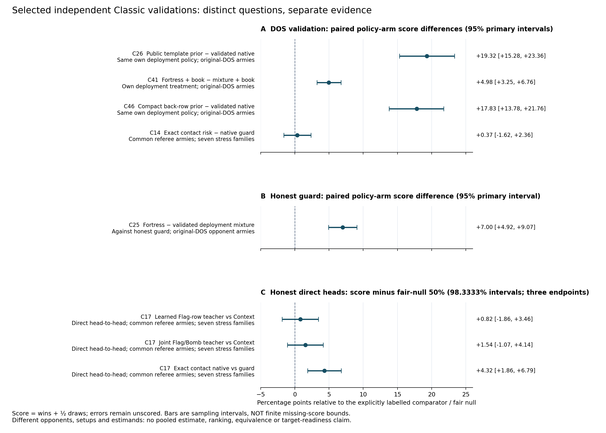

# Independent-validation aggregate figure



The figure displays eight predefined endpoints from six completed independent
validation cycles. It includes the null C14 DOS result and ALL THREE C17 honest
heads, including the two inconclusive teacher endpoints. It is a selected
explanatory summary, not an inventory of every validation in the campaign.
Rows retain the requested order rather than being sorted by their effects.

Panel A shows matched policy-arm score differences against DOS. Each row labels
its distinct comparator and deployment context. Panel B shows the Fortress
deployment contrast against an honest guard. Panel C uses a DIFFERENT estimand:
each candidate's direct head-to-head score minus its fair-null score of 50%.
It is not a controlled policy-arm difference. Comparators' full immutable IDs,
opponents, setup modes and families are recorded in the CSV.

Error bars are retained bootstrap sampling intervals: primary 95% intervals for
C14/25/26/41/46 and the planned three-endpoint 98.3333% intervals for C17. They
are not finite missing-score bounds. Those separate bounds are preserved in
CSV columns, including C17's zero-width finite bounds when no outcomes are
missing. Score means wins plus half draws; none of these percentages is a win
rate. There is no pooling, ranking, equivalence, human-generality or target
readiness inference across these different experiments. C17's exact-contact
honest-head result and C14's inconclusive DOS result illustrate the importance
of keeping populations separate.

`generate.py` reads ONLY each cycle's aggregate `plan.json` and `result.json`.
No saved matches, trajectories, deployments or other validation data are opened.
It writes a full-precision CSV, standalone PNG and vector PDF, source SHA-256
bindings and a numeric review. The review independently checks eight manually
transcribed effect anchors, endpoint inclusion, interval selection and units.
The PNG was visually inspected for legibility and clipping. The rendering uses
Matplotlib 3.6.3 with its bundled/system DejaVu Sans fonts and the noninteractive
Agg backend; no package or network installation was needed.

From repository root:

```
python3 docs/ai-honest-campaign-2026-10-15/research/validation-summary-figure-v1/generate.py
```

`source-bindings.json` and every CSV row bind the exact original aggregate
inputs. `manifest.json` binds all final artifacts. Regeneration is a local
visualization of existing results, not a new strength test, reanalysis of
trajectories or policy change. Source files and completed cycle evidence remain
unchanged.
